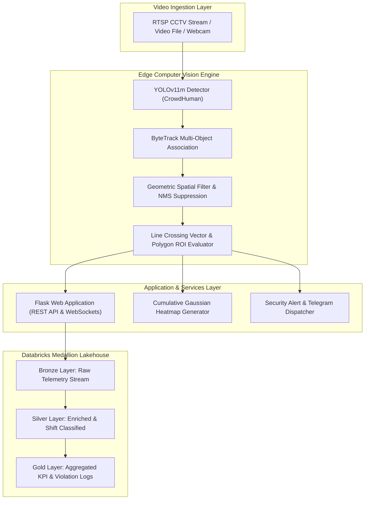

# SmartCrowd: Real-Time Pedestrian Analytics & CCTV Traffic Monitoring

> An enterprise-oriented Computer Vision and analytics platform for pedestrian counting, bi-directional flux estimation, perimeter security, and automated crowd density surveillance. Powered by fine-tuned **YOLOv11**, **ByteTrack** multi-object tracking, and a **Databricks Medallion Lakehouse** architecture.

[](https://minhunhooo-smartcrowd-visionai.hf.space)
[](https://github.com/MinHung1411/smartcrowd-visionai)
[](https://www.python.org/)
[](https://github.com/ultralytics/ultralytics)
[](https://github.com/ifzhang/ByteTrack)
[](LICENSE)

---

### Quick Demo Access
- **Production URL**: [https://minhunhooo-smartcrowd-visionai.hf.space](https://minhunhooo-smartcrowd-visionai.hf.space)
- **Evaluation Account**: `demo` / `demo123` *(Pre-filled on login page — click **Đăng nhập vào hệ thống**)*
- **Admin Account**: `admin` / `admin123` *(Full configuration and administrative access)*

---

## Technical Overview

SmartCrowd is designed to address real-world challenges in smart building management, transit hubs, and retail surveillance:
- **Occlusion Handling**: Robust identification in dense pedestrian crowds where bodies overlap significantly.
- **Bi-directional Flux Estimation**: Directional vector tracking across virtual gates (detecting entry **IN** vs exit **OUT**).
- **Perimeter Security (Polygon ROI)**: Millisecond intrusion verification against custom multi-point geometric zones.
- **Persistent Spatial Thermal Maps**: Motion coordinate accumulation providing visual density distribution over time.
- **Cloud Lakehouse Integration**: Schema-enforced Bronze/Silver/Gold Delta Lake pipelines for downstream BI reporting and compliance audits.

---

## System Architecture



---

## Core Capabilities

| Capability | Engineering Approach | Specification / Target |
|---|---|---|
| **Pedestrian Detection** | YOLOv11m fine-tuned on CrowdHuman | mAP@0.5: **95.8%**, mAP@0.5:0.95: **84.8%** |
| **Object Tracking** | ByteTrack with Kalman Filter motion smoothing | ID-switch resilience, trajectory retention (12–30 frames) |
| **Line Crossing (IN/OUT)** | Vector dot-product across virtual boundary line | Directional entry/exit counting with occupancy estimation |
| **Perimeter Virtual Fence** | Ray-casting point-in-polygon (`cv2.pointPolygonTest`) | Millisecond intrusion alarm on pedestrian foot centroid |
| **Video Analytics Pipeline** | Multi-threaded frame processing with H.264 web transcode | Full video traffic timeline, speed optimization slider (1x/2x/3x) |
| **Spatial Density Heatmap** | 2D Gaussian kernel accumulation with OpenCV Colormap JET | Visual thermal overlay indicating foot traffic congestion points |
| **Incident Dispatcher** | Non-blocking alert thread with cooldown throttling | Telegram Bot API & Webhook notification delivery |
| **Lakehouse Architecture** | Databricks Unity Catalog (Bronze → Silver → Gold) | Hourly aggregation, shift breakdown, audit logs |

---

## Model Evaluation & Benchmark

The core detection engine is fine-tuned from **YOLOv11 Medium** on the **CrowdHuman Benchmark** (15,000 dense training images, 4,370 validation scenes):

| Metric | YOLOv11m (CrowdHuman Fine-tuned) | Baseline (COCO Person) | Improvement |
|---|:---:|:---:|:---:|
| **mAP@50** | **95.8%** | 71.0% | +24.8% |
| **mAP@50-95** | **84.8%** | 45.0% | +39.8% |
| **Precision** | **88.0%** | 76.5% | +11.5% |
| **Recall** | **90.1%** | 68.2% | +21.9% |
| **Inference Latency (GPU)** | **~8ms** (NVIDIA Tesla T4) | ~8ms | Real-time 60+ FPS |
| **Inference Latency (CPU)** | **~35ms** (Intel / AMD Multi-thread) | ~32ms | Real-time 20+ FPS |

---

## Databricks Lakehouse Pipeline (Medallion)

Traffic events and occupancy metrics transition through 3 structured Delta Lake tiers:

1. **Bronze (`bronze.raw_crowd_detections`)**: Captures raw streaming sensor payloads including timestamp, camera identifier, `current_count`, `in_count`, `out_count`, and boolean alert flags.
2. **Silver (`silver.crowd_traffic_enriched`)**: Normalizes schema, removes duplicate records, and engineers 6 analytical attributes:
   - `time_shift`: Categorizes into `MORNING_PEAK`, `AFTERNOON`, `EVENING_PEAK`, and `NIGHT_OFFPEAK`.
   - `traffic_intensity`: Classifies congestion tier (`LIGHT`, `MODERATE`, `HEAVY`, `CRITICAL`).
   - `net_occupancy`: $\max(0, \text{total\_in} - \text{total\_out})$.
   - `is_weekend`: Binary flag for pattern isolation.
3. **Gold (Executive Analytical Views)**:
   - `gold.hourly_crowd_traffic`: Hourly volume, inflow/outflow balance, and peak volume.
   - `gold.shift_occupancy_summary`: Operational shift breakdown for facility staffing.
   - `gold.overcrowding_safety_alerts`: Compliance audit trail of safety threshold breaches.

---

## Getting Started

### Prerequisites
- Python 3.10 or 3.11
- Virtual camera, webcam, or CCTV video footage (`.mp4`, `.avi`, `.mov`)
- (Optional) NVIDIA GPU with CUDA 11.8+ for hardware-accelerated batch video processing

### Local Installation

```bash
# 1. Clone repository
git clone https://github.com/MinHung1411/smartcrowd-visionai.git
cd smartcrowd-visionai

# 2. Create and activate virtual environment
python -m venv venv
# On Windows:
venv\Scripts\activate
# On Linux/macOS:
# source venv/bin/activate

# 3. Install core dependencies
pip install -r requirements.txt pytest pyyaml

# 4. Run test suite
python -m pytest tests/ -v

# 5. Launch web application
cd src
python run.py
```

Access the dashboard at `http://localhost:5000`.

---

## Repository Structure

```
smartcrowd-visionai/
├── src/                               # Application source code
│   ├── app/
│   │   ├── models/                    # SQLAlchemy models (User, Detection)
│   │   ├── services/
│   │   │   ├── crowd_service.py       # YOLOv11m + ByteTrack + ROI + Video engine
│   │   │   ├── alert_service.py       # Telegram & Webhook notification dispatcher
│   │   │   └── db_service.py          # Databricks Lakehouse / SQLite sync
│   │   ├── templates/                 # Production web templates (Tailwind CSS)
│   │   │   ├── detection/camera.html  # Live camera tracking & interactive polygon fence
│   │   │   ├── detection/video.html   # Video batch processing & timeline chart
│   │   │   ├── dashboard.html         # Operational KPI overview & traffic curves
│   │   │   └── auth/login.html        # Secure authentication view
│   │   └── views/                     # Flask Blueprints (auth, detection, main)
│   ├── config/config.py               # Runtime environment configuration
│   ├── best.pt                        # Fine-tuned YOLOv11 Medium model weights
│   └── run.py                         # Standalone server entrypoint
├── sql/                               # Databricks Lakehouse SQL DDL & transformations
│   ├── 01_create_schemas.sql          # Catalog & schema definitions
│   ├── 02_bronze_from_app.sql         # Bronze layer ingest
│   ├── 03_silver_enriched.sql         # Silver enrichment & feature engineering
│   └── 04_gold_tables.sql             # Gold summary aggregation tables
├── tests/                             # Automated test suite
│   ├── test_app.py                    # Application route and authentication tests
│   └── test_ingestion.py              # Data ingestion pipeline unit tests
├── .github/workflows/ci.yml           # Automated CI/CD validation pipeline
├── requirements.txt                   # Production dependency specifications
└── README.md                          # Technical documentation
```

---

## Author

**Hồ Minh Hưng**
- GitHub: [@MinHung1411](https://github.com/MinHung1411)
- Hugging Face: [@minhunhooo](https://huggingface.co/minhunhooo)
- Email: `hmhung1411@gmail.com`

---

## License

This project is licensed under the [MIT License](LICENSE).
