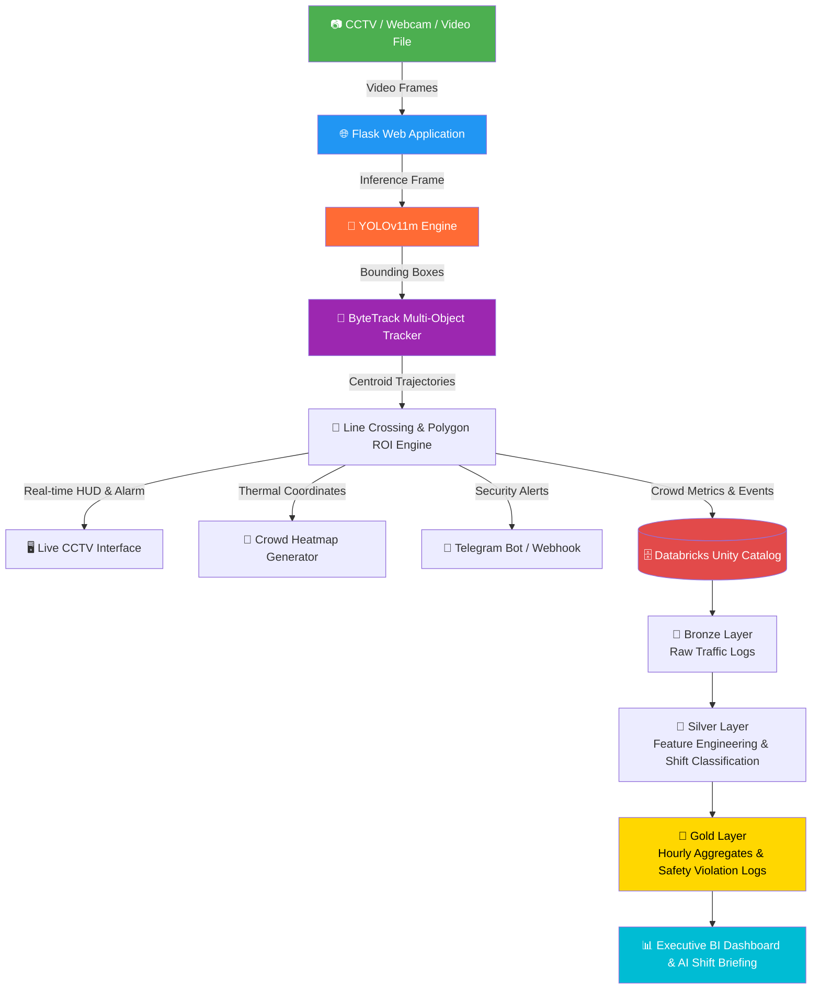

<div align="center">

# 🚶‍♂️ SmartCrowd: Real-Time Crowd Analytics & People Counting Platform
### AI-Powered Multi-Object Tracking (YOLOv11 + ByteTrack) with Cloud Data Lakehouse Architecture (Databricks Unity Catalog)

[](https://minhunhooo-smartcrowd-visionai.hf.space)&nbsp;&nbsp;[](https://github.com/MinHung1411/smartcrowd-visionai)&nbsp;&nbsp;[](https://github.com/MinHung1411)

<p align="center">
  
  
  
  
  
  
  
  
</p>

> ### 🚀 Live Production Demo
> - **Live Web App**: [minhunhooo-smartcrowd-visionai.hf.space](https://minhunhooo-smartcrowd-visionai.hf.space)
> - **Default Credentials**: dmin / dmin123 *(Pre-filled on login page — simply click Sign In)*
</div>

---

## 📋 Table of Contents
- [Overview](#-overview)
- [Key Features](#-key-features)
- [System Architecture](#-system-architecture)
- [Model Evaluation & Benchmarks](#-model-evaluation--benchmarks)
- [Surveillance Virtual Fence (Polygon ROI)](#-surveillance-virtual-fence-polygon-roi)
- [Video Analytics & Traffic Timeline](#-video-analytics--traffic-timeline)
- [Databricks Medallion Lakehouse](#-databricks-medallion-lakehouse)
- [Quick Start](#-quick-start)
- [Project Structure](#-project-structure)
- [Author](#-author)
- [License](#-license)

---

## 🔍 Overview

**SmartCrowd** is an enterprise-grade Computer Vision and Big Data analytics platform engineered to monitor, count, and analyze pedestrian flow and crowd density in public spaces (smart buildings, retail stores, transit stations, and events).

The system seamlessly bridges **Edge Computer Vision** with a **Cloud-Native Data Lakehouse**:
1. **Real-time Edge Vision**: Utilizes a fine-tuned **YOLOv11 Medium** model combined with **ByteTrack** multi-object tracking to detect persons in dense crowds, maintain unique identities, and track bi-directional virtual line crossing (**IN / OUT**).
2. **Surveillance Virtual Fence (Polygon ROI)**: Allows security operators to draw custom restricted zones on live CCTV feeds, detecting intrusions with millisecond latency and triggering automated audio-visual alarms.
3. **CCTV Video Analytics Pipeline**: Upload and analyze surveillance footage (`.mp4`, `.avi`, `.mov`) with timeline traffic profiling, unique visitor counting, and downloadable annotated video.
4. **Cloud Data Lakehouse (Medallion Pipeline)**: Continuously streams traffic events and density metrics into **Databricks Unity Catalog**, running automated **Bronze → Silver → Gold** ETL pipelines for real-time BI reporting, peak hour detection, and safety compliance audits.

> 🌐 **Live Model Demo**: [minhunhooo-smartcrowd-visionai.hf.space](https://minhunhooo-smartcrowd-visionai.hf.space)

---

## ✨ Key Features

| Feature | Description | Technology |
|---|---|---|
| 🚶‍♂️ **Dense Crowd Detection** | Detects people in overlapping, crowded scenes without missing small/occluded bodies | YOLOv11m fine-tuned on CrowdHuman |
| 🔄 **Bi-directional Counting** | Virtual crossing line detects direction: entry (**IN +1**) vs exit (**OUT +1**) | ByteTrack + Line Crossing Vector |
| 🛡️ **Surveillance Virtual Fence** | Draw custom polygon restricted zones on CCTV view with intrusion detection | OpenCV `pointPolygonTest` + Audio Synth |
| 📹 **Full Video Analytics** | Upload surveillance videos with speed/accuracy slider, generating timeline charts & MP4 export | Multithreaded ByteTrack Video Pipeline |
| 🏢 **Occupancy Monitoring** | Live calculation of current persons in the area and net occupancy ($\text{IN} - \text{OUT}$) | Real-time Sliding Window State |
| ⚠️ **Overcrowding Safety Alert** | Immediate visual alarm and database flag when crowd count exceeds safety threshold | Dynamic Threshold Detector |
| 🎨 **Crowd Density Heatmap** | Accumulates movement paths and overlays a thermal density map on CCTV view | Gaussian Blur + OpenCV Colormap JET |
| 🚨 **Incident Dispatcher** | Instant security incident notification with photo snapshots | Telegram Bot API + Webhook Integration |
| 📑 **AI Executive Briefing** | Generates executive shift reports with 1-click clean PDF / Print export | Local Analytics LLM Engine |
| 📊 **Databricks Analytics** | Hourly traffic distribution, peak shift summary, and safety violation audit logs | Databricks Unity Catalog (SQL) |
| 🔐 **User Management** | Role-based access control (Admin / Operator), audit logging, and CSV export | Flask-Login + bcrypt |

---

## 🏗️ System Architecture



---

## 📊 Model Evaluation & Benchmarks

The core vision model was fine-tuned from **YOLOv11m** on the challenging **CrowdHuman Benchmark** (15,000 train images, 4,370 validation images) using NVIDIA Tesla T4 GPU acceleration:

| Metric | Value | Comparison vs Baseline |
|---|:---:|:---:|
| **Architecture** | **YOLOv11 Medium (`best.pt`)** | SOTA Ultralytics release |
| **Dataset** | **CrowdHuman (Dense Crowds)** | Benchmark standard |
| **mAP@50** | **95.8%** | +24.8% over COCO default |
| **mAP@50-95** | **84.8%** | +39.8% over COCO default |
| **Precision** | **88.0%** | Minimal false positives |
| **Recall** | **90.1%** | Detects heavily occluded persons |
| **Inference Latency** | **~8ms (GPU) / ~35ms (CPU)** | 60+ FPS Real-time capability |
| **Tracking Algorithm** | **ByteTrack (`bytetrack.yaml`)** | ID-consistent tracking |

---

## 🛡️ Surveillance Virtual Fence (Polygon ROI)

Operators can dynamically draw arbitrary polygon zones on the camera feed:
- **Interactive ROI Canvas**: Click to place boundary vertices on the CCTV canvas.
- **Intrusion Detection**: Uses ray-casting point-in-polygon tests (`cv2.pointPolygonTest`) against pedestrian foot centroids.
- **Audio-Visual Alarm**: Highlights intruders in neon red, triggers Web Audio API alarm synthesizer, and dispatches incident snapshot to Telegram.
- **Preset Quick-Zones**: Includes 1-click presets for *Main Entrance (Center)*, *Corridor (Left)*, and *Stage Area (Bottom)*.

---

## 📹 Video Analytics & Traffic Timeline

Upload surveillance footage to run batch analytics:
- **Throughput Optimization**: Frame skipping slider (Full Fidelity vs 2x/4x Ultra Fast).
- **Timeline Foot Traffic**: Second-by-second pedestrian density graph rendered via Chart.js.
- **Output Video**: Download annotated MP4 with trajectory tracks, IDs, and HUD overlays.
- **Accumulated Video Heatmap**: Instant thermal hotspot snapshot summarizing the entire video.

---

## ☁️ Databricks Medallion Lakehouse

Traffic metrics and safety alerts flow through 3 structured Delta Lake layers:

### 1. 🥉 Bronze Layer (`bronze.raw_crowd_detections`)
Raw view joining web telemetry and user audit trails: captures timestamp, camera identifier, `people_in_frame`, `total_entered`, `total_exited`, `density_level`, and `is_overcrowded`.

### 2. 🥈 Silver Layer (`silver.crowd_traffic_enriched`)
Cleaned and enriched with **6 engineered analytical features**:
- `hour_of_day`: 0 – 23 hour bucket.
- `time_shift`: `MORNING_PEAK`, `AFTERNOON`, `EVENING_PEAK`, `NIGHT_OFFPEAK`.
- `traffic_intensity`: `LIGHT` (<5), `MODERATE` (5-15), `HEAVY` (16-25), `CRITICAL_CONGESTION` (>25).
- `net_occupancy`: $\max(0, \text{total\_entered} - \text{total\_exited})$.
- `latency_grade`: `REALTIME_FAST` (<50ms) vs `ACCEPTABLE`.
- `is_weekend`: Weekday vs Weekend traffic flag.

### 3. 🥇 Gold Layer (Executive Analytics Tables)
- `gold.hourly_crowd_traffic`: Hourly volume, inflow/outflow, and peak crowd sizes.
- `gold.shift_occupancy_summary`: Density distribution by operational work shifts.
- `gold.overcrowding_safety_alerts`: Audit trail of all safety limit violations for compliance reporting.
- `gold.ai_inference_performance`: Latency percentiles, min/max runtime, and effective processing FPS.
- `gold.ml_experiment_log`: Benchmark history comparing YOLOv8, YOLOv10, and YOLOv11.

---

## 🚀 Quick Start

### Prerequisites
- Python 3.10+
- Webcam or video file
- (Optional) Databricks workspace credentials or SQLite fallback (auto-configured)

### 1. Clone & Set Up Virtual Environment

```bash
git clone https://github.com/MinHung1411/smartcrowd-visionai.git
cd smartcrowd-visionai

# Create virtual environment
python -m venv venv
venv\Scripts\activate       # On Windows
# source venv/bin/activate  # On macOS/Linux

# Install dependencies
pip install -r src/requirements.txt
```

### 2. Configure Environment (Optional)

```bash
cp src/.env.example src/.env
# Edit src/.env with Telegram Bot Token or Databricks credentials if desired
```

### 3. Launch the Web Application

```bash
cd src
python run.py
```

Open your browser at **`http://localhost:5000`**

**Default Credentials:**
- **Username:** `admin`
- **Password:** `admin123`

---

## 📁 Project Structure

```
smartcrowd-visionai/
│
├── src/                               # Web Application Source
│   ├── app/
│   │   ├── models/                    # SQLAlchemy ORM (User, Detection)
│   │   ├── services/
│   │   │   ├── crowd_service.py       # YOLOv11m + ByteTrack + ROI + Video Engine
│   │   │   ├── alert_service.py       # Telegram & Webhook Incident Dispatcher
│   │   │   └── db_service.py          # Database & Databricks synchronization
│   │   ├── templates/                 # Jinja2 HTML (Cyberpunk Dark HUD)
│   │   │   ├── detection/camera.html  # Live CCTV People Counting & Virtual Fence
│   │   │   ├── detection/video.html   # Video Footage Analytics & Timeline Profiler
│   │   │   ├── detection/upload.html  # Image Crowd Density Analysis
│   │   │   ├── dashboard.html         # Executive Analytics & AI Shift Briefing
│   │   │   └── history.html           # Historical Audit Log
│   │   └── views/                     # Flask Blueprints (main, detection, auth)
│   ├── best.pt                        # YOLOv11m fine-tuned model (~40.5 MB)
│   ├── config/config.py               # Application configurations
│   ├── requirements.txt               # Dependencies
│   └── run.py                         # Application entrypoint
│
├── sql/                               # Databricks Lakehouse SQL Pipelines
│   ├── 01_create_schemas.sql          # Bronze, Silver, Gold schemas
│   ├── 02_bronze_from_app.sql         # Raw traffic data view
│   ├── 03_silver_enriched.sql         # Feature engineering table
│   ├── 04_gold_tables.sql             # 4 Business intelligence summary tables
│   └── 05_mlflow_experiment.sql       # MLflow experiment log & benchmark
│
├── docker/                            # Production Docker configurations
├── docs/                              # Architecture diagrams and demo images
└── README.md                          # Project documentation
```

---

## 👨‍💻 Author

**Hồ Minh Hưng**
- GitHub: [@MinHung1411](https://github.com/MinHung1411)
- Hugging Face: [@minhunhooo](https://huggingface.co/minhunhooo)
- Email: `hmhung1411@gmail.com`

---

## 📄 License

This project is open-source and licensed under the [MIT License](LICENSE).
